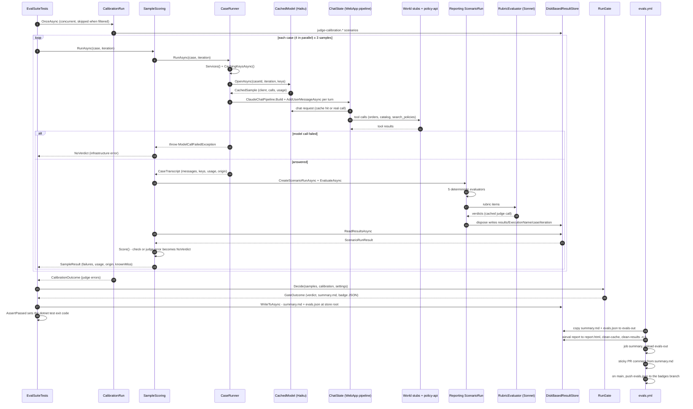

# How an evals run flows

One run of `tests/ShoppingAssistant.Evals`, from `EvalSuiteTests` down to the results store, and how CI (`.github/workflows/evals.yml`) reports it. A static copy is in [evals-run-flow.png](evals-run-flow.png); this Mermaid source is the one to edit.

Results leave the test along two paths:

- **The evidence for each sample.** Reporting writes it when a scenario run is disposed (step 19), and `SampleScoring` reads it back (steps 20–21), so the gate scores exactly what `dotnet aieval report` shows.
- **The verdict.** `RunGate` writes `summary.md` and `evals.json` to the root of the store (step 27), and CI turns them into the job summary, the PR comment and the badge.

A failed model or judge call becomes `NoVerdict`, an infrastructure error, never a failed check.

